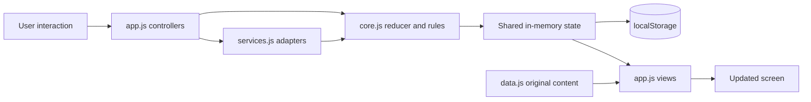

# Architecture: one store, small boundaries

The app is a static website using native JavaScript modules. `index.html` loads `app.js`; the browser follows its imports. Node serves the files during development and runs tests. It is not an application API server.

An action describes something that happened, such as `SAVE_JOURNAL`. The reducer computes the next state. `createStore()` saves that state and exposes it to the views. A view returns markup from the current state. `render()` replaces the application markup. That is why DOM event handlers are attached once to `document`, rather than to buttons that will be replaced.

## File responsibilities

| File | Responsibility | Useful symbols |
|---|---|---|
| `dist/src/data.js` | Original text/catalogs and educational feature notes | `prompts`, `questions`, `cards`, `lessons`, `providers`, `costs`, `mechanics` |
| `dist/src/core.js` | Rules and persisted state; no DOM/network | `initialState`, `reducer`, `scoreCheckin`, `remainingSeconds`, `restore`, `createStore` |
| `dist/src/services.js` | Replaceable boundaries | `replyTo`, `duoReflection`, `createAmbient` |
| `dist/src/app.js` | Screen templates, event handling, routing and downloads | `shell`, `render`, `navigate`, `sendChat`, each `*View` function |
| `dist/styles.css` | Layout, states, responsive breakpoints and artwork | `.sidebar`, `.hero`, `.two-grid`, `.message`, media queries |
| `server.mjs` | Loopback static file serving | `createServer` |

## State model

| State | Meaning |
|---|---|
| `plan`, `chatUses` | Demo entitlements and allowance consumption |
| `messages`, `stars` | Conversation messages and saved message IDs |
| `duo` | Room code, active speaker and local shared messages |
| `results`, `journals` | Completed check-ins and reflection records |
| `card`, `savedCards` | Current sample card and saved card indices |
| `timer` | Deadline while running; remaining seconds while paused |
| `reminders` | Local due times and whether each notice has been shown |
| `completed`, `favourites` | Lesson IDs rather than duplicate lesson text |
| `posts`, `liked`, `vote` | Local social content and this demo user's choices |
| `bookings` | Fictional provider/slot records |

An ID links related records without copying them. For example, a saved lesson is just `pause`, and the catalog supplies its title and content. A production database would give these relationships explicit tables and ownership rules.

## Persistent versus temporary state

The store persists completed work. Temporary controller variables hold an unfinished journal draft, the selected lesson, a booking review, the search filter and whether chat is pending. Reloading restores saved records, not unfinished drafts or pending requests. The hash selects the screen, such as `#journal`; it is not a server route.

`localStorage` is synchronous, origin-specific and unencrypted. It has no user accounts, multi-device synchronization, concurrency control or authorization. A browser that blocks writes leaves the app working in memory and displays a persistence notice.
