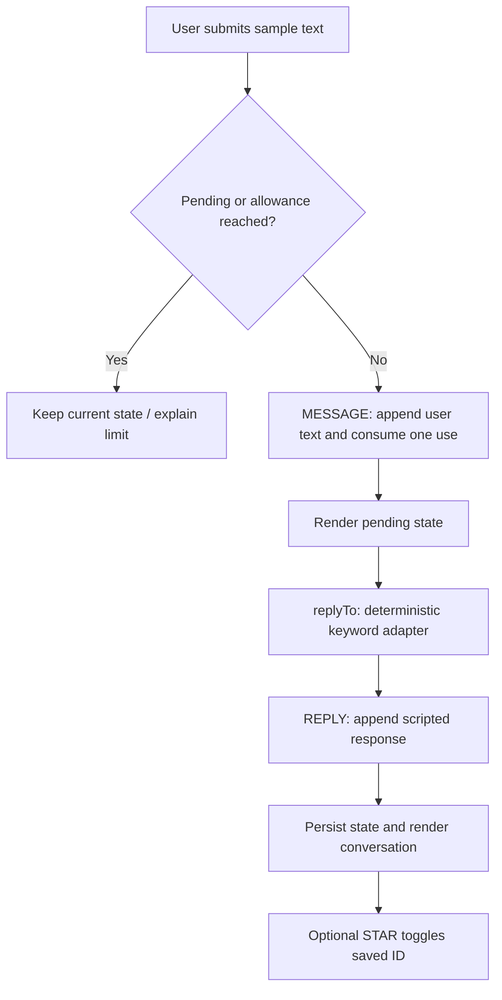

# Read the code by following an action

## The chat boundary



`sendChat()` in `app.js` is the controller. It rejects blank text and prevents overlapping sends. The reducer also enforces the allowance, so the view's disabled button is not the only check. A short `setTimeout()` simulates a wait; it is not a network request or a streamed model response.

`replyTo()` in `services.js` returns `{kind, text}`. The result can be replaced later without changing the message shape or chat view. A production adapter should call your backend; the backend owns provider credentials and authoritative allowance checks. A browser quota is easily edited and is only a demonstration.

If you change screens while a reply is pending, the response still enters the store. The controller redraws immediately only when Chat is active, avoiding replacement of another feature's in-progress form.

## A reducer is a small transaction description

In `core.js`, this case creates a new state object and a new journal array:

```js
case 'SAVE_JOURNAL':
  return { ...s, journals: [a.entry, ...s.journals] };
```

`...s` keeps unrelated fields. The new entry is placed before earlier entries. Returning a new object makes the operation easy to reason about and test. This does not supply database transactions, multi-client consistency, or access control.

`createStore()` calls the reducer and serializes the result under `still-prototype-v1`. `restore()` rejects wrong-version or malformed snapshots. Storage failures keep an in-memory app and set a flag so the interface can explain the limitation. Schema migration is intentionally absent: an incompatible version falls back to fresh state.

## Transparent scoring

`scoreCheckin()` verifies four integers between 1 and 5. The minimum sum is 4 and the maximum is 20:

```js
const score = Math.round(((sum - 4) / 16) * 100);
```

The arithmetic is easy to inspect and the tests cover endpoints, midpoint and invalid input. Its labels are original sample copy. This is an example of implementing an assessment engine, not evidence of Healo's scoring or a clinical instrument.

## Time is a deadline

A running timer records `end = now + remaining * 1000`. The display is computed from `end - now`. Pausing converts that difference back to remaining seconds. This handles ordinary timer throttling more accurately than subtracting one every second. It does not protect against a changed system clock or guarantee background execution.

Reminders use the same timestamp idea but a separate list. The polling interval fires only while the page runs. A real reminder service needs a persistent scheduler and a delivery provider.

## Rendering and safe text

`escapeHTML()` escapes user text before it enters HTML templates. The app uses plain text for community thoughts and chat rather than accepting arbitrary rich HTML. Search updates only the posts container so the search input keeps focus as you type.

Native labels, fieldsets, radio groups, buttons, status toasts, focus styles, a skip link and reduced-motion CSS provide basic accessibility support. These are a starting point, not a claim of a complete accessibility audit.

Views are deliberately ordinary functions, such as `journalView()`. `shell()` wraps the current view in shared navigation and header. `navigate()` maps hash routes to a fixed list of view functions, stops audio, renders, and focuses the main region.

## Why the event handlers are delegated

Replacing `#app.innerHTML` replaces its buttons. Listeners directly attached to those buttons would disappear. One click listener on `document` uses `closest('[data-action]')` to find the clicked action, including clicks on an SVG inside a button. A separate submit listener reads `FormData` and routes each form to its controller.

For a larger app, separate `app.js` into feature folders and introduce a rendering framework or smaller DOM updates. The current file keeps the small example easy to trace without framework setup.

## IDs, relationships and duplicate prevention

Messages, entries, reminders and posts use generated IDs. Saved message and lesson lists contain IDs, not full duplicated records. A local booking checks the pair `(provider, slot)` before insertion. A real booking system needs a unique constraint or transaction on the server; this browser check cannot prevent two users reserving the same slot.

## Audio lifecycle

`createAmbient()` allocates an AudioContext only after a user gesture. Its oscillators connect to a low-gain output. The context is closed when the user stops playback, changes screens, or leaves the page. This is synthesized audio, not a downloaded meditation or a treatment.
