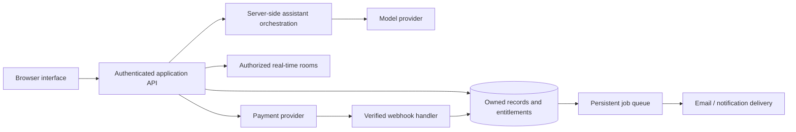

# From a local model to a real service

The diagram below is a proposed architecture for a future application. It is not a finding about Healo's private systems.



## Replace boundaries in this order

| Local teaching shortcut | Next implementation responsibility |
|---|---|
| One localStorage key | Authenticated API and database rows owned by a user |
| `replyTo()` | Server assistant adapter, request cancellation, structured events, retries and usage ledger |
| `costs` and `SET_PLAN` | Server-authoritative entitlements, expiry, verified purchase events and atomic consumption |
| Local Duo code | Server-owned room, membership checks, invitation expiry, per-message speaker identity and real-time transport |
| Check-in formula | Versioned, appropriately validated assessments with attempt/result provenance |
| Browser reminder interval | Persistent jobs with time-zone rules, delivery retries and cancellation |
| Fake provider slots | Availability service with atomic reservation, expiry, cancellation and provider confirmation |
| Browser posts | Owned records, moderation, reporting, visibility and rate controls |
| Local library progress | Media/content service, authorized URLs, progress synchronization and rights management |

## A small proposed API surface

These names are design examples, not captured Healo endpoints:

```text
GET    /api/me
POST   /api/conversations
POST   /api/conversations/:id/messages
POST   /api/rooms
POST   /api/rooms/:id/join
POST   /api/checkins
GET    /api/checkins
POST   /api/journal-entries
POST   /api/reminders
GET    /api/providers/:id/availability
POST   /api/bookings
POST   /api/payment-webhooks
```

Every route must check the authenticated user's access to the target object. A room code alone is not proof of identity. Do not move provider API keys into browser source. Payment success comes from verified server events, not a browser button or query parameter.

## Data entities to start with

Use owned users, conversations/messages, room memberships, assessment versions/attempts/results, journal entries, reminders, content/progress records, providers/slots/bookings, community posts/votes, and entitlement/credit events. Decide on retention, export, deletion and audit responsibilities before accepting real sensitive data.

## Preserve what is useful

Keep pure functions such as score validation and deadline calculation independently testable. Replace storage through a small repository/service interface. Preserve view-level states for loading, error, retry and empty results. Introduce real authentication before shared records, and server authorization before public community or Duo access.

An AI mental-health product also needs qualified clinical input, evaluated safety behavior, current verified support resources, privacy engineering and operational review. The demo's keyword branches cannot provide those guarantees.

## A sensible next vertical slice

Implement one authenticated user, one conversation, one server-side assistant response and a persisted message list. Then prove that a second user cannot read it. Add journal persistence next, then one complete assessment engine, before introducing real-time rooms, payments or booking concurrency.
